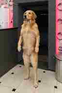
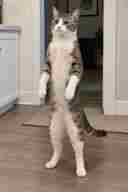

# Shared pet anthropomorphism / pose-preparation proposal

**Status:** BACKLOG — design and reference examples only; **no implementation or testing scheduled**  
**Date:** 2026-10-17  
**Scope:** A reusable, product-agnostic optional capability for any Genjutsu AI image/video workflow involving pets. **Not tied to any particular template, page, or provider.**

## Background and intent

Ordinary cat/dog photographs frequently show quadruped, seated, lying, or partly occluded postures. Human-motion driving videos may yield a begging/squatting pose, extra human-looking fingers/hands, or insufficient motion. An optional *image editing* step could convert the pet into a full-height upright anthropomorphic character **before** any downstream image/video model runs.

This has **not been validated across models**. Animal-driving-video workflows may outperform it and should remain the default where appropriate. Never guarantee identity preservation, perfect anatomy, or motion replication.

**Product principle:** pet anthropomorphism is an explicit optional *preprocessing tool*, not a hardcoded feature of any one generator.

## Reference assets (AI-generated, no customer data)

These are synthetic visual **pose guides only**. The source pet's actual identity and background must come from the user's input. Repository assets are small 128×192 JPEG *documentation thumbnails* (not production-quality reference images). For future experiments, use/export the higher-resolution originals rather than these thumbnails.

| Preset | Illustration | Repository file |
| --- | --- | --- |
| `dog-upright-v1` |  | `docs/assets/pet-anthropomorphism/dog-upright-v1.jpg` |
| `cat-upright-v1` |  | `docs/assets/pet-anthropomorphism/cat-upright-v1.jpg` |

Required pose characteristics: **fully erect vertical torso, high hips, two extended weight-bearing rear legs with planted feet, visible furry front limbs ending in paws**. Avoid crouching, sitting or “begging” posture.

Select a same-species reference by default. A dog pose image can guide a cat in a quick exploratory test, but same-species imagery reduces cross-species identity contamination.

## Applicability matrix

| User goal | Proposed behavior |
| --- | --- |
| Pet performing **animal-style** movement | Keep original photo; use pet-friendly motion model / animal reference video. No pose prep by default. |
| Pet performing **human-style bipedal** motion | *Offer* optional pose prep and approval before transferring to a human-motion provider. |
| Preserve natural quadruped anatomy | Do not anthropomorphize. |
| Other product/image/video tool involving a pet | Make the shared preprocessor available **only** if the workflow benefits and the user opts in. |

The feature should never silently change a user's pet into a human-shaped character.

## Proposed shared workflow (not implemented)

```text
User pet photo (Image 1, identity + source background) ──┐
                                                         ├→ optional image edit
Preset dog/cat pose guide (Image 2, geometry only) ──────┘       ↓
                                                     Upright character image
                                                                ↓
                                             User preview / accept / retry / skip
                                                                ↓
                                     Any compatible downstream image/video workflow
```

**Future boundaries:**

1. Design a small, shared and model-independent preprocessor, e.g. `src/modules/pet-anthropomorphism/`, called by any supported product. No page-specific imports, branching or duplicated generators.
2. A request carries a user-owned source image plus a preset identifier, never an arbitrary image URL chosen by the client. The server resolves an allowlisted/versioned pose guide asset.
3. Wrap a tested fal image-edit provider (possible candidates Nano Banana edit and Seedream edit). Verify current model IDs, two-reference support, billing, supported formats and upstream usage rules **at implementation time**.
4. Keep original uploads unchanged. Put generated intermediate photos behind owner-scoped R2 access and store generation status; show a side-by-side preview. The new photo becomes the downstream reference **only after user approval**.
5. Keep provider routing, credits, history, recovery, refunds, moderation, and existing product modes untouched. Quote any image-edit step separately before charge.
6. Privacy: use only synthetic example assets in this repository. Do not commit user uploads or include information about private uploads in outward-facing notices.

## Universal two-image editing prompt (cat or dog)

```text
Create a realistic, fully upright anthropomorphic version of the pet from
Image 1, designed to be suitable for later human-style motion transfer.

Image 1 is the ONLY identity and scene source: preserve the same species,
face, eyes, ears, nose, muzzle, fur color, distinctive markings and
recognizable identity, as well as its original lighting and background.

Use Image 2 ONLY as a reference for posture and body proportions: a tall
vertical torso, elevated hips, two long fully extended weight-bearing
hind legs with both feet planted, and relaxed furry forelimbs ending in
natural animal paws. Do NOT copy Image 2's animal identity, species,
markings, background or lighting.

The animal is completely upright, like a person standing at attention,
with its entire body visible from head to toes. Do NOT make it sit,
crouch, squat, kneel, or beg on bent rear legs.

The character must clearly remain the same animal. No realistic human
hands, fingers, human skin, clothing, costume, or extra limbs. Adapt
floor/framing only as needed to show the full standing body.
```

**Roles:** Image 1 = uploaded animal; Image 2 = same-species pose guide. Map source IDs explicitly using the provider's supported image ordering/labels; do not assume textual labels are honored automatically.

### Single-image fallback

Use if the provider or user does not support a second image. Only upload the **user's original pet photo**:

```text
Edit this exact pet into a realistic anthropomorphic character standing
COMPLETELY upright like a person, with elevated hips, a long vertical
torso and two fully extended hind legs supporting its weight. Both feet
touch the ground; furry front limbs hang naturally at the sides and end
in real animal paws, not human hands. Preserve the exact animal identity,
species, fur, face, surroundings and lighting as far as possible. Show
the full body. NOT sitting, squatting, begging or crouching; no human
fingers, clothing or extra limbs.
```

Without a pose guide the model may revert to a begging/squatting stance.

## Experiment later — not now

When there's engineering time, use **synthetic or explicitly consented** dog/cat test sets (lying, sitting, standing, partially occluded). A/B compare: natural photo + animal motion; natural photo + human motion; one-image upright edit + human motion; two-image upright edit + human motion. Keep the driving video/provider constant across comparable runs.

Judge recognizable identity and species, animal paws (not fingers), straight legs vs crouch, extra limbs, source-background retention, motion quality, spend/accepted output and latency. If useful, then draft a separate engineering plan with UI, authenticated R2 inputs, versioned guides, retry limits, billing/refunds, tests and feature flag (off by default).

**Explicitly out of scope today:** image tests, API integration, UI, generator logic, backend/provider changes, account or billing changes, pricing, deployment, or scheduled follow-up work. This file and the two synthetic *pose thumbnails* are only a durable reference for future investigation.
