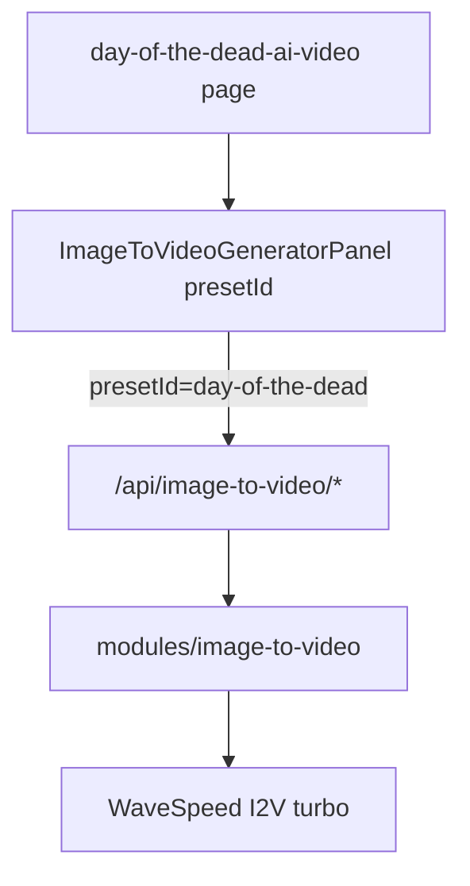
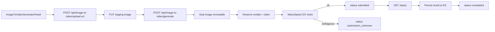

# Day of the Dead AI Video page

Add `/day-of-the-dead-ai-video` as a Bulin-style SEO landing with Enzo-like left-demo / right-upload UI. Generation goes through a **generic image-to-video engine** (WaveSpeed `bytedance/seedance-2.0/image-to-video-turbo`), not a page-scoped API. DotD is the **first preset** on that engine (same acceptance bar as hotel-lobby: next holiday page = register preset + page, not a new API stack).

**Status:** revised after ChatGPT review rounds 1–2 + abstraction feedback (2026-10-26). Address remaining P1/P2 before implementation.

## Todos

- [ ] Extract shared WaveSpeed HTTP/poll to `src/core/ai/` + shared credit markup to `src/lib/`
- [ ] Create **`image-to-video` module** (presets registry, pricing, storage+conditional seal, billing claim/`submission_unknown`/stale-claim, service, assert) with locked model constant
- [ ] Add **`/api/image-to-video/*`** (upload-url, generate, status, result, optional template-meta/source)
- [ ] Register **one** `IMAGE_TO_VIDEO_SCENE` in `LISTABLE_GENERATION_SCENES` + `generationMediaBasePath` → `/api/image-to-video`; persist result to R2 before `completed`
- [ ] Wire admin generations media for the **image-to-video** scene (not per landing page)
- [ ] Register DotD preset (`day-of-the-dead` + person|pet variants) in I2V presets
- [ ] Build panel (shared `ImageToVideoGeneratorPanel` with `presetId`, or thin DotD wrapper) + DotD route/SEO/i18n/assets
- [ ] Tests (billing, seal, preset prompt lock, admin media) + `pnpm build`

## Architecture (locked)



| Layer      | What                                                                                                                            |
| ---------- | ------------------------------------------------------------------------------------------------------------------------------- |
| **Engine** | `src/modules/image-to-video/` + `/api/image-to-video/*` — upload 1 image, seal, reserve, submit I2V, poll, save result, history |
| **Preset** | Registry entry (e.g. `day-of-the-dead`) — locked prompts, defaults, displayName, creditDescription, demo paths for panel        |
| **Page**   | Route + SEO + i18n only; panel takes `presetId="day-of-the-dead"` (mirror `HotelLobbyGeneratorPanel`)                           |

**Do not** ship `/api/day-of-the-dead/*` or a DotD-only billing/storage stack.

### Decisions

- **Upstream model (engine constant, not ENV):** `bytedance/seedance-2.0/image-to-video-turbo` in I2V constants (like hotel-lobby locks Kling O3). No `SEEDANCE_WAVESPEED_I2V_TURBO_MODEL`; do not follow `GENJUTSU_*_PROVIDER`. Credentials only: `WAVESPEED_API_KEY` / base URL. Persist `provider`+`model`+`presetId` (+ variant) on the task at create.
- **Scene:** single listable scene `image-to-video` (name TBD in code). Product identity = `options.presetId` (+ `variant` / `subject` for person|pet). Admin/history filter by scene; display name from preset.
- **Inputs:** one photo; left-side video on landings is **demo only** (not sealed into the job).
- **Defaults (v1 engine / DotD preset):** `duration: 5`, `resolution: '720p'`, `aspect_ratio: '9:16'`, `generate_audio: true`.
- **Credits:** WaveSpeed I2V rates → `src/lib/ai-credits` markup. 720p **$0.14/s**, 1080p **$0.16/s**.
- **Prompts:** server-locked per preset; DotD has **person | pet** variants (see § Locked prompts). Client cannot free-edit.
- **Locales:** `en`, `ja`, `ko`, `es`, `pt-BR`, `fr`, `de` (no `zh`). Full `site.dotd.*` in every locale file.
- **Customer copy:** no WaveSpeed / Seedance names.



## Review fixes (must ship with v1)

### P1 — Submit idempotency and ambiguous outcomes

Engine-owned state machine (patterned on hotel-lobby billing/reconcile), **not** page-specific:

| Status                                | Meaning                                                                                              |
| ------------------------------------- | ---------------------------------------------------------------------------------------------------- |
| `initiated`                           | upload-url created `ai_task`; staging key bound                                                      |
| `ready` (or equivalent)               | image sealed; eligible to reserve                                                                    |
| `reserved`                            | credits held                                                                                         |
| `submitting`                          | exclusive claim; store **`submittingClaimedAt`**                                                     |
| `submitted`                           | upstream `requestId` persisted                                                                       |
| `submission_unknown`                  | timeout / 5xx / bind fail / **stale claim after process death** — credits held, **no auto-resubmit** |
| `processing` / `completed` / `failed` | poll / terminal                                                                                      |

Rules:

1. CAS claim `ready|reserved` → `submitting`; persist `submittingClaimedAt`.
2. Persist `provider` / `model` / `requestId` / sealed key / `presetId` / variant before success.
3. Ambiguous submit → `submission_unknown` + ops log; never auto-resubmit.
4. **Stale `submitting`:** TTL on `submittingClaimedAt` → CAS to `submission_unknown`. If `requestId` present → poll only; else manual ops — no new submit. Process death does not run catch.
5. Refund only on confirmed upstream failure / never-started with safe proof.
6. Tests: double-click, claim race, unknown holds credits, fail refunds, **kill after claim** (with/without `requestId`).

### P1 — Immutable image input

Staging PUT is overwriteable. Seal under **engine** prefix, e.g. `image-to-video/sealed-inputs/{userId}/{generationId}/{sealId}.{ext}`:

1. Ownership + MIME/size checks.
2. HEAD → ETag; **conditional / ETag-bound copy** to a **unique never-reused** sealed key; no overwrite of existing sealed keys.
3. Task CAS binds the sole `sealedImageKey`; concurrent losers discard orphans and reuse winner.
4. WaveSpeed gets a short-lived signed URL of the CAS-fixed sealed object only; later calls never re-seal from staging if bound.
5. Tests: HEAD-then-overwrite; concurrent seal → one winner.

### P2 — Module boundaries

| Concern                                     | Location                            |
| ------------------------------------------- | ----------------------------------- |
| WaveSpeed HTTP / poll                       | `src/core/ai/`                      |
| Credit markup                               | `src/lib/ai-credits.ts`             |
| I2V engine (presets, seal, billing, submit) | `src/modules/image-to-video/*` only |

Engine must **not** import `@/modules/genjutsu/*` or `@/modules/hotel-lobby/*`. Pages/components call `/api/image-to-video/*` only.

### P2 — History, admin, result persistence

1. `IMAGE_TO_VIDEO_SCENE` in `LISTABLE_GENERATION_SCENES`; `generationMediaBasePath` → `/api/image-to-video`.
2. Persist output to R2 before `completed`.
3. Product `result` / optional `source` routes under `/api/image-to-video/`.
4. **Admin media** (`admin/generations/$generationId/media.ts`): add **one** image-to-video task lookup + sealed-key ownership + signed read — not a DotD-named branch. List thumbs use scene + `options.presetId` / displayName. Acceptance: admin previews another user’s **I2V** sealed input (including DotD jobs).

### P2 — Person vs pet (DotD preset variants)

Within preset `day-of-the-dead`, server variants `person` | `pet` with separate locked prompts. UI toggle; SEO pet section stays. Do not reuse person prompt for pets.

### P2 — i18n

All enabled locales get `site.dotd.*` + meta; FAQ JSON-LD matches visible FAQ.

## Locked prompts (DotD preset)

### Person (`variant: 'person'`)

```
Transform the person in the uploaded photo into an elegant Mexican Day of the Dead (Día de los Muertos) character through a magical, cinematic transformation.

**Identity Preservation:** Keep the exact same person throughout the video. Preserve their original facial structure, recognizable identity, hairstyle, body proportions, and natural expressions.

**Transformation:** The person looks directly at the camera as glowing golden marigold petals gently swirl around them. Beautiful traditional Mexican sugar skull (Catrina) makeup gradually appears on their face, featuring intricate black eye decorations, delicate floral patterns, and elegant ornamental details. Their clothing transforms into a richly decorated traditional Day of the Dead outfit.

**Environment:** The background gradually transforms into a magical Mexican Day of the Dead celebration at night, with glowing candles, vibrant orange marigold flowers, colorful papel picado banners, and warm golden lights.

**Motion:** The person gently tilts their head, blinks naturally, and gives a subtle, mysterious smile. Their hair and clothing move softly in the breeze. Marigold petals float gracefully through the scene.

**Camera:** A continuous cinematic medium close-up shot with a very slow, smooth camera push-in. No cuts or sudden camera movements.

**Visual Style:** Photorealistic, cinematic, magical realism, rich orange and purple colors, warm candlelight, intricate makeup details, beautiful festive atmosphere, premium film quality.

**Constraints:** Maintain consistent facial identity, realistic anatomy, stable facial features, and smooth temporal consistency. No face swapping, no identity changes, no distorted facial features, no extra limbs, no sudden scene cuts.
```

### Pet (`variant: 'pet'`)

Draft (tune in QA; server-locked):

```
Transform the pet in the uploaded photo into a magical Mexican Day of the Dead (Día de los Muertos) portrait through a cinematic transformation.

**Identity Preservation:** Keep the exact same animal throughout the video. Preserve species, breed, fur or feather color and pattern, ear/eye shape, body proportions, and recognizable markings. Do not turn the animal into a human or change species.

**Transformation:** The pet faces the camera as glowing golden marigold petals swirl gently. Delicate sugar-skull style markings appear as painted accents on the fur (forehead and cheeks), with marigold petals — never human clothing, never a human face.

**Environment:** Background becomes a candlelit ofrenda at night: candles, orange marigolds, colorful papel picado, warm gold light.

**Motion:** Soft natural micro-motion — blink, slight head tilt, fur moving in a light breeze; petals drift through the frame.

**Camera:** Continuous medium close-up, very slow push-in, no cuts.

**Visual Style:** Photorealistic, cinematic, magical realism, rich orange and purple, warm candlelight, premium film quality.

**Constraints:** Stable animal identity, realistic anatomy, no anthropomorphic body, no extra limbs, no face swap to a person, no sudden cuts.
```

## 1. Shared WaveSpeed + credits

- `src/core/ai/wavespeed.ts`: `submitWavespeedPrediction(model, body)`, poll/normalize; key/base URL only from config.
- Engine passes hardcoded I2V turbo model; core does not ENV-route sd2.5 vs sd2.0.
- Payload: `{ image, prompt, duration, resolution, aspect_ratio, generate_audio }`.
- `src/lib/ai-credits.ts`: markup helper used by I2V pricing.

## 2. Engine module

`src/modules/image-to-video/`:

| File           | Role                                                                                                                           |
| -------------- | ------------------------------------------------------------------------------------------------------------------------------ |
| `constants.ts` | `IMAGE_TO_VIDEO_SCENE`, **`IMAGE_TO_VIDEO_MODEL = 'bytedance/seedance-2.0/image-to-video-turbo'`**, duration/resolution bounds |
| `presets.ts`   | Registry: `day-of-the-dead` (+ future presets); `promptFor(preset, variant)`, public meta                                      |
| `pricing.ts`   | I2V cost → credits                                                                                                             |
| `storage.ts`   | staging / seal / result under `image-to-video/…`                                                                               |
| `billing.ts`   | reserve / claim / stale→unknown / settle / refund                                                                              |
| `service.ts`   | submit + reconcile; persist result before completed                                                                            |
| `assert.ts`    | preset allowlist, one image, ownership                                                                                         |

**Acceptance:** adding another I2V trend page = new preset + landing + messages — **not** a new API/billing module.

## 3. API routes

`src/routes/api/image-to-video/`:

- `upload-url.ts` — auth; `presetId`; create task; signed PUT for 1 image
- `generate.ts` — seal → estimate → reserve → claim → WaveSpeed → `requestId` or `submission_unknown`
- `status.ts` — poll / stale submitting / save R2 / settle
- `result/$generationId.ts` — history download
- optional `template-meta.ts` / `source/$generationId.ts` — panel meta / input preview
- Update `admin/generations/$generationId/media.ts` for **image-to-video** scene

## 4. Generator UI

Prefer shared `ImageToVideoGeneratorPanel` with `presetId` (and variant control when preset supports it), same left/right layout as Enzo:

- Left: preset demo video/poster (static public assets)
- Right: person|pet (when DotD), one photo, Generate
- Calls `/api/image-to-video/*` only
- No free-text prompt

DotD page: `<ImageToVideoGeneratorPanel presetId="day-of-the-dead" />` (or thin wrapper for copy-only chrome).

## 5. Page + SEO

`src/routes/day-of-the-dead-ai-video.tsx` + SeoSections — marketing only; generator is the shared panel.

## 6. Assets

- `public/videos/day-of-the-dead-ai-video-demo.mp4` + poster (preset preview)
- optional OG + pet demos

## 7. Verify

- Engine billing/seal tests; DotD preset prompt lock; listable scene; admin I2V input preview
- `pnpm build`
- Paid smoke only with operator-confirmed WaveSpeed spend

## Out of scope

- Page-bound `/api/day-of-the-dead/*`
- Genjutsu objects-swap / hotel-lobby Kling as DotD backend
- Client-editable free prompt / duration UI (v1)
- Homepage gallery card (later)
- Auto-retry submit on `submission_unknown`
- Second I2V preset beyond DotD (registry shape must allow it; shipping another page is later)
