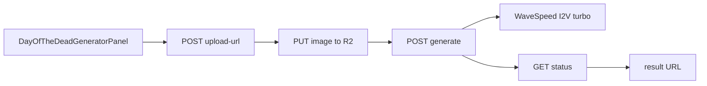

# Day of the Dead AI Video page

Add `/day-of-the-dead-ai-video` as a Bulin-style SEO landing with Enzo-like left-demo / right-upload UI, backed by a new thin product API that calls WaveSpeed `bytedance/seedance-2.0/image-to-video-turbo` with a locked prompt (not Genjutsu seal, not hotel-lobby Kling).

## Todos

- [ ] Add WaveSpeed image-to-video-turbo submit + estimate + env in `seedance-wavespeed` / config
- [ ] Create `day-of-the-dead-ai-video` module (constants, pricing, storage, billing, service, assert)
- [ ] Add `/api/day-of-the-dead` upload-url, generate, status, result handlers
- [ ] Build `DayOfTheDeadGeneratorPanel` (left demo + right 1 photo + generate)
- [ ] Add route, SeoSections, FAQ/Breadcrumb JSON-LD, i18n keys, asset placeholders
- [ ] Tests + `pnpm build`

## Decisions (locked)

- **API:** WaveSpeed `bytedance/seedance-2.0/image-to-video-turbo` — one photo + fixed prompt; left video is **demo only** (not sealed into the job).
- **Prompt:** server-locked (not editable in UI). Full text in § Locked prompt below.
- **Pipeline:** new product module + `/api/day-of-the-dead/*` — **not** `/api/genjutsu/*` (no template seal) and **not** hotel-lobby Kling presets.
- **Defaults (v1):** `duration: 5`, `resolution: '720p'`, `aspect_ratio: '9:16'`, `generate_audio: true`. No duration/resolution picker on the page yet.
- **Credits:** provider cost from WaveSpeed table → `calculateGenjutsuCredits` (same markup path as hotel-lobby). Rates: 720p **$0.14/s** ($0.70 / 5s), 1080p **$0.16/s** ($0.80 / 5s).
- **Customer copy:** do not name WaveSpeed / Seedance (AGENTS rule); phrase as Day of the Dead / Genjutsu product.
- **Assets:** placeholder paths under `public/videos/`; drop in real demo/OG later.



## Locked prompt

```
Transform the person in the uploaded photo into an elegant Mexican Day of the Dead (Día de los Muertos) character through a magical, cinematic transformation.

**Identity Preservation:** Keep the exact same person throughout the video. Preserve their original facial structure, recognizable identity, hairstyle, body proportions, and natural expressions.

**Transformation:** The person looks directly at the camera as glowing golden marigold petals gently swirl around them. Beautiful traditional Mexican sugar skull (Catrina) makeup gradually appears on their face, featuring intricate black eye decorations, delicate floral patterns, and elegant ornamental details. Their clothing transforms into a richly decorated traditional Day of the Dead outfit.

**Environment:** The background gradually transforms into a magical Mexican Day of the Dead celebration at night, with glowing candles, vibrant orange marigold flowers, colorful papel picado banners, and warm golden lights.

**Motion:** The person gently tilts their head, blinks naturally, and gives a subtle, mysterious smile. Their hair and clothing move softly in the breeze. Marigold petals float gracefully through the scene.

**Camera:** A continuous cinematic medium close-up shot with a very slow, smooth camera push-in. No cuts or sudden camera movements.

**Visual Style:** Photorealistic, cinematic, magical realism, rich orange and purple colors, warm candlelight, intricate makeup details, beautiful festive atmosphere, premium film quality.

**Constraints:** Maintain consistent facial identity, realistic anatomy, stable facial features, and smooth temporal consistency. No face swapping, no identity changes, no distorted facial features, no extra limbs, no sudden scene cuts.
```

## 1. WaveSpeed I2V turbo helpers

Extend `src/modules/genjutsu/seedance-wavespeed.ts` (reuse key/base URL + poll):

- Export thin `submitWavespeedPrediction(model, body)` (or dedicated `submitWavespeedImageToVideoTurbo`).
- Payload: `{ image, prompt, duration, resolution, aspect_ratio, generate_audio }`.
- Keep using `getWavespeedSeedanceStatus` / `normalizeWavespeedSeedanceTask`.
- Add `estimateWavespeedImageToVideoTurboCost({ duration, resolution })`.
- Env: `SEEDANCE_WAVESPEED_I2V_TURBO_MODEL` default `bytedance/seedance-2.0/image-to-video-turbo` in `src/config/index.ts` + `.env.example`.
- Unit tests in `seedance-wavespeed.test.ts` for payload + estimate.

## 2. Product module

New `src/modules/day-of-the-dead-ai-video/`:

| File           | Role                                                                               |
| -------------- | ---------------------------------------------------------------------------------- |
| `constants.ts` | product id, locked `DEFAULT_PROMPT`, duration/resolution/aspect, demo/poster paths |
| `pricing.ts`   | estimate credits via WaveSpeed I2V cost + `calculateGenjutsuCredits`               |
| `storage.ts`   | staging key for one image; public URL for WaveSpeed                                |
| `billing.ts`   | reserve / mark submitted / settle / refund on `ai_task` (mirror hotel-lobby shape) |
| `service.ts`   | `submitDayOfTheDead` → WaveSpeed I2V; status reconcile                             |
| `assert.ts`    | one image, locked prompt, auth product gates                                       |

Locked prompt stored server-side only; generate ignores any client prompt field.

## 3. API routes

Under `src/routes/api/day-of-the-dead/`:

- `upload-url.ts` — auth, create/bind `ai_task`, signed PUT for 1 image
- `generate.ts` — estimate → reserve credits → submit WaveSpeed → persist request id
- `status.ts` — poll WaveSpeed, settle/refund, return video URL
- `result/$generationId.ts` — download/proxy if other products do

Thin handlers only; logic in the module.

## 4. Generator UI

New `src/components/landing/DayOfTheDeadGeneratorPanel.tsx`, layout aligned with `EnzoFernandezAiGeneratorPanel.tsx`:

- `lg:grid-cols-[0.9fr_1.1fr]`: left demo via `FixedTemplatePreview` (static `/videos/day-of-the-dead-ai-video-demo.mp4` + poster — **not** `/api/genjutsu/template`)
- Right: one photo slot, hints (front-facing · self or pet · one subject), Add photo + Generate
- Chrome labels: `Day of the Dead AI video · 1 photo` / fixed-template copy via i18n
- Flow: credit gate → upload-url → upload → generate → poll status (same UX rhythms as Enzo/Bulin panels)
- No prompt textarea

## 5. Page + SEO

`src/routes/day-of-the-dead-ai-video.tsx`:

- **URL:** `https://genjutsuai.net/day-of-the-dead-ai-video`
- **Title:** Day of the Dead AI Video: Make Your Own From One Photo
- **Description:** Día de los Muertos runs November 1–2. Turn one photo of yourself or your pet into a sugar-skull AI video with marigolds and a candlelit ofrenda. Free to try.
- Hero + `#generator` panel (Bulin placement)
- SEO body: what it is, how-to, prompt ideas (copy-only list), pets section, compare table, Spanish block, compliance, FAQ, closing CTA
- Prefer colocated `DayOfTheDeadSeoSections.tsx` like Enzo
- JSON-LD: FAQPage + BreadcrumbList (visible FAQ text must match FAQ JSON-LD)
- Pet example slots: 3 placeholder cards; empty until assets land

i18n: `site.dotd.*` in `messages/en.json` and `messages/zh.json` (and other locale files if the repo requires parity for build).

## 6. Assets / placeholders

Expect (gitkeep or documented paths; no fake generated video):

- `public/videos/day-of-the-dead-ai-video-demo.mp4` + `-poster.jpg`
- optional `public/og/day-of-the-dead-ai-video.jpg`
- optional `public/videos/demos/day-of-the-dead-pet-0{1,2,3}.*` for pet examples

Until files exist, UI uses poster fallback / muted empty state so the page still builds.

## 7. Verify

- Module unit tests for pricing + prompt lock
- `pnpm build`
- Manual: signed-in generate against WaveSpeed when `WAVESPEED_API_KEY` is set (operator runs paid calls)

## Out of scope

- Genjutsu objects-swap / video-edit template seal
- Hotel-lobby Kling preset
- Client-editable prompt / duration UI
- Homepage gallery card (can add later in `motion-templates.ts`)
