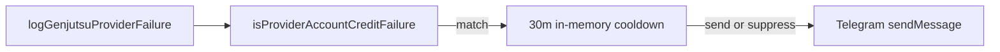

# Lightweight Telegram ops alerts — design

Trigger: Genjutsu admin showed paid users refunded with `PROVIDER_FAILED · 400` and Higgsfield dump `Insufficient credits. Please top up your account…`. Root cause was **our upstream provider account balance**, not end-user Genjutsu credits. We want a cheap ops ping when that class of failure repeats.

Status: **design locked; implementation not started.**

---

## Locked decisions

| Topic    | Choice                                                                                                 |
| -------- | ------------------------------------------------------------------------------------------------------ |
| Scope    | **Upstream account-credit failures only** (not all `PROVIDER_FAILED`, not user `INSUFFICIENT_CREDITS`) |
| Dedup    | **By alert type**, **30 minutes**, include suppressed count on the next send                           |
| Config   | **Env/secrets only** (`TELEGRAM_BOT_TOKEN`, `TELEGRAM_CHAT_ID`); Admin settings later                  |
| Delivery | Must never block or fail the refund/generate path                                                      |
| Approach | Small `src/lib/ops-alert/` helper (not Sentry / Cloudflare Issues for v1)                              |

---

## Architecture

Hook once in [`src/modules/genjutsu/provider-errors.ts`](../../../src/modules/genjutsu/provider-errors.ts) inside `logGenjutsuProviderFailure` so existing callers already cover:

- [`src/routes/api/genjutsu/generate.ts`](../../../src/routes/api/genjutsu/generate.ts)
- [`src/routes/api/genjutsu/status.ts`](../../../src/routes/api/genjutsu/status.ts)
- [`src/routes/api/genjutsu/webhook.ts`](../../../src/routes/api/genjutsu/webhook.ts)

---

## Implementation plan

### 1. Config

Add to [`src/config/index.ts`](../../../src/config/index.ts) and document in [`.env.example`](../../../.env.example):

- `telegram_bot_token` ← `TELEGRAM_BOT_TOKEN`
- `telegram_chat_id` ← `TELEGRAM_CHAT_ID`

Unset either → notify is a no-op (safe in local/dev).

Production: set Cloudflare Worker secrets (`wrangler secret put`); do not commit real tokens.

### 2. New lib (not a cross-module import)

Create under `src/lib/ops-alert/`:

- `provider-account-credit.ts` — classifier
  - Match provider dumps like: `top up`, `please top up`, `top up your account`, `insufficient credits` **plus** account/balance wording
  - Prefer patterns that distinguish provider billing from our user-facing `Insufficient credits: need X, balance Y` (those do not go through this logger today; still keep the classifier conservative)
- `telegram.ts` — `sendTelegramMessage(text)`; POST `https://api.telegram.org/bot{token}/sendMessage`; swallow/log failures
- `cooldown.ts` — process-local `globalThis` Map (same pattern as [`src/lib/rate-limit.ts`](../../../src/lib/rate-limit.ts))
  - Key: `provider_account_credits` (error type; provider name goes in the message body)
  - Window: **30 minutes** from last successful send attempt
  - Within window: increment `suppressedSinceSend`, skip send
  - After window: send, include `suppressedSinceSend` if > 0, then reset
- `notify.ts` — `maybeNotifyProviderAccountCreditFailure({ providerError, provider?, generationId?, stage? })`
  - Classify → cooldown → format short ops message → fire-and-forget `void send…().catch(…)`
  - Message fields: alert type, stage, generationId, truncated providerError, suppressed count; **no user email/PII**

### 3. Wire-up

In `logGenjutsuProviderFailure`, after `console.error`, call `maybeNotifyProviderAccountCreditFailure` (fire-and-forget). Pass `providerError`, `generationId`, `stage`. Default message title: `Genjutsu provider account credit failure`.

### 4. Tests

- Classifier: match Higgsfield-style “Insufficient credits. Please top up your account…”, reject unrelated provider/content-safety messages
- Cooldown: first fires; second within 30m suppressed; after advance clock fires with suppressed count

### 5. Out of scope (v1)

- Admin settings UI
- Cloudflare Issues / Sentry
- KV-backed durable cooldown (Workers multi-isolate may rarely double-send; acceptable)
- Alerting for likeness/content-safety/submission_unknown

---

## Ops setup (after implementation)

1. Create a Telegram bot via BotFather; get token
2. Get chat id (DM or group; bot must be able to message it)
3. Set Worker secrets `TELEGRAM_BOT_TOKEN` / `TELEGRAM_CHAT_ID` (and local `.env.development` for smoke test)
4. Trigger or wait for a provider account-credit failure; confirm one Telegram message, then suppress within 30m

---

## Implementation todos

- [ ] Add `TELEGRAM_BOT_TOKEN` / `TELEGRAM_CHAT_ID` to envConfigs + `.env.example`
- [ ] Implement classifier, cooldown, Telegram client, `maybeNotify` in `src/lib/ops-alert/`
- [ ] Fire-and-forget notify from `logGenjutsuProviderFailure`
- [ ] Unit tests for classifier + 30m cooldown/suppressed count
